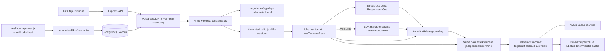

# Keskkonnaportaali arhitektuuri- ja otsinguuuring

Uuendatud: 10.11.2026

**Kehtiv allikapoliitika:** Statistikaamet on avalikest tulemustest, vastustest ja diagrammidest välistatud. Allpool mainitud PXWeb-adapterite tehnilised piirid säilivad ajalooliste skeemilepingutena, mitte avaliku tõendi erandina. Toetatud metsadiagrammid kasutavad Keskkonnaagentuuri SMI töövihikut; puuduva primaarse rea asemel ei kuvata teise väljaandja graafikut. Vt [allikaregister](ALLIKAD.md).

## Mida avalikust portaalist kinnitati

- Lehe HTML-i generaatori metaandmed näitavad, et [keskkonnaportaal.ee](https://keskkonnaportaal.ee/) töötab Drupal 11 peal.
- [Portaali otsing](https://keskkonnaportaal.ee/et/search?search_api_fulltext=mets) on serveris renderdatud Drupal View/Search API laadne GET-otsing. Päringuparameeter on `search_api_fulltext`, lehekülgi juhib `page` ja lehe suurust `items_per_page`.
- 18.08.2026 ajalooline `mets` auditi-snapshot sisaldas 953 tulemust. Varasem uuring loendas tühja päringu kataloogis 6057 otsingukaarti, kuid selle eraldi vaatluse täpne kuupäev ei ole siin dokumenteeritud. Need arvud ei kirjelda tänast katvust.
- [Sitemap](https://keskkonnaportaal.ee/sitemap.xml) jaguneb kaheks leheks ja sisaldas 01.10.2026 inventuuris kokku 8463 URL-i. XML-is olev iga `loc` kontrollitakse eraldi täpselt Keskkonnaportaali hosti vastu; portaali sitemap ei saa välisele hostile `official` taset edasi anda. Eraldi heakskiidetud ametlike väljaandjate sitemap'id parsitakse oma hostipoliitikaga.
- Avalik `/jsonapi` ei olnud kasutusel (404). Seetõttu ei eeldata dokumenteerimata Drupal JSON:API lepingut: korpus kasutab avalikku sitemap'i, otsingukaarte ja valitud lehtede puhastatud HTML-täisteksti.
- [robots.txt](https://keskkonnaportaal.ee/robots.txt) välistab haldus- ja sisemised rajad. Sünkroonija värskendab faili vähemalt kord tunnis, rakendab `Allow`/`Disallow` pikima vaste reeglit ning kasutab ainult lubatud avalikke sisulehti, väikest paralleelsust, viivitust, mahu- ja ajapiire. Robots-fail, read, grupid, reeglid, mustri pikkus ja metamärkide arv on eraldi piiratud; `*`-sobitus kasutab regexivaba järjestikust matcher'it. Upstream'i kuvatud tulemuste arv ei ole ressursieelarve: kataloogil on 20 000 dokumendi / 400 lehe ülempiir, lehti moodustatakse laisalt ning tühi või täielikult korduv leht peatab jooksu. HTML-i `robots` meta ja vastuse `X-Robots-Tag: noindex` välistavad sisu indeksist. Iga ümbersuunamise siht kontrollitakse enne päringut uuesti HTTPS-i ja algselt lubatud hosti vastu; keha loetakse voogedastavalt kuni baitpiirini enne parsimist.

Need tähelepanekud kirjeldavad avalikult nähtavat liidest, mitte Keskkonnaagentuuri privaatset infrastruktuuri. „Drupal View/Search API” on HTML-i vormi ja klasside põhjal tehtud tehniline järeldus; portaali sisemist seadistust projekt ei näe.

## Praktikarakenduse andmevoog

1. Server kontrollib korpuse vanust käivitumisel ja seejärel kord tunnis; kui viimane edukas jooks on vanem kui seadistatud 24 tundi, loeb sünkroonija portaali sitemap'i, heakskiidetud ametlike väljaandjate sitemap'id (`keskkonnaagentuur.ee`, `keskkonnaamet.ee`, `kliimaministeerium.ee`, `rmk.ee`, `www.ilmateenistus.ee`, `terviseamet.ee`, `kik.ee`), laiema portaaliotsingu ning etteantud tähtpäringud, näiteks `mets`. Portaali sitemap'i Drupal'i `?page=`-leheküljestamist ja ametlike sitemap'ide indekseid järgitakse; iga hosti `robots.txt` kontrollitakse enne lugemist ning ühe allika tõrge ei katkesta teiste jooksu.
2. URL-id kanoniseeritakse, duplikaadid ühendatakse ja metaandmed kirjutatakse PostgreSQL-i. Väike eestikeelne Vikipeedia taustakogu lisatakse eraldi allikatasemega; ajalooline läbi vaadatud metsakorpus jääb eval-materjaliks ega sisene primaarotsingu indeksisse.
3. Valitud sisulehtedelt kõigilt lubatud ametlikelt hostidelt eemaldatakse menüüd, vormid, skriptid ja muu lehekroom. Puhas täistekst talletatakse ainult serveris. Igapäevane piiratud partii eelistab sisuta ja kõige vanemalt proovitud kirjeid, nii et katvus kasvab progressiivselt ega lae alati sama algust uuesti. Täissünkroonimiste vahel jätkab eraldi piiratud taustapartii tühjade ja aegunud lehetekstide täitmist, nii et kogu indeks ei pea ootama järgmist 24-tunnist jooksu.
   Kui lehe uuesti lugemine ebaõnnestub, ei tõesta säilinud vana tekst värsket fakti. Katse saab pärast seitsmepäevast ooteaega tagasi piiratud järjekorda; uus edukas lugemine taastab tõendusõiguse. Edukalt loetud leht jõuab värskendusjärjekorda kuue päeva järel, enne seitsmepäevase tõendusakna lõppu. Vigane ajalooline ajamärge ei tohi tervet taustapartii päringut katkestada; päring kasutab PostgreSQL 16 või uuema versiooni kuupäevakontrolli.
   Avalik `/api/corpus` eristab salvestatud teksti arvu `hydrated` ja viimase seitsme päeva edukalt loetud ametlike lehtede arvu `freshOfficialPages`. Viimane ei taga iga lehe sobivust konkreetseks tõendiks. `robotsExcluded` sisaldab ka noindex tõttu välja jäetud kirjeid ning `lastSync.errorCount` näitab viimase jooksu vigade arvu ilma veateksti avaldamata.
4. Kasutaja otsing käivitab ühe ühise kandidaadivoo: PostgreSQL, kolm ametlikku Valitsusportaali indeksit ja päringule sobiv tüübikindel XML-, JSON-, CSV-, JSON-stat2- või WFS-adapter töötavad paralleelselt; tulemused deduplikeeritakse, filtreeritakse ning järjestatakse relevantsuse järgi. Hüdroloogia PostgREST-adapter saadab ainult serveris kureeritud jaamakoodi, seeria ja tunnise 36 tunni alampiiri ning hoiab „viimati avaldatud” tunniandmed reaalajapäringust eraldi. Kliima PostgREST-adapter seob ühe 25 kureeritud jaama koodi, fikseeritud `DTA08` elemendi ja ühest lubatud minevikukuupäevast eraldatud aasta/kuu/päeva; see nõuab üht sama identiteediga rida, täpset skeemi, °C ühikut ja allika avaldamisajatemplit. EELISe Emajõe adapter kasutab ainult fikseeritud `eelis:avalikud_vooluveekogud` kihti, KKR-koodi ja seitset väljanime. Nimega Natura adapter seob ühe kuuest kureeritud loodusalast serveris hoitava täpse nime, EL-i ja KKR-koodiga ning küsib `f_rahvalad` teenuselt fikseeritud kümmet välja; isikliku tegevusõiguse, ajaloolise seisu või mitme ala päring lükatakse enne välispäringut tagasi. Statistikaameti KK048, KK25 ja KK068 adapterid kasutavad eraldi redirectideta HTTPS POST-transporti, fikseeritud 2024. aasta Eesti koondmõõtmeid ning 256 kB vastusepiiri. KK610 seob ühe sõnaselge aasta 2002–2024 jäätmete kogusumma ja näitajaga „taaskasutamine”; määrad, alaliigid, kohalik ulatus ja võrdlused ei sisene adapterisse. Kasutaja toortekst ei jõua EELISe ega PXWeb päringufiltrisse või POST-kehasse, vana API `updated` väli ei muutu avaldamisajaks ning puuduva allalaadimisaja või stale-vastusega tõendit ei looda. Sama kanoonilise URL-i aliaste välju võib rikastada, kuid adapteriga seotud projektsioon jääb koos oma tõendikeha, hash'i, poliitika ja lokaatoriga atomaarseks; ainult sarnase pealkirjaga eri URL-idest valitakse üks terviklik kirje. Mitmesõnaline SQL-kandidaat kasutab meeldejäämiseks mõisterühmade `OR`-päringut; range kõiki rühmi kattev `AND`-päring jääb järjestussignaaliks, nii et üks puuduv kvalifitseerija ei tühjenda tulemuste lehte. Käänded ja sünonüümid on rühma sees alternatiivid. Päringuanalüüs lisab vajaliku allikarolli, näiteks reaalaja ilma, registri, ajaloolise vaatluse, näitaja või juhendi; läbi vaadatud täpne teenusevastendus jääb kehtima ka siis, kui lühike kataloogikaart ei korda kõiki päringu sõnu, kuid ei anna teemavälisele dokumendile vastamisõigust. Küsitud andmeaasta otsitakse tõendi pealkirjast ja tekstist ning seda ei samastata artikli avaldamisaastaga. Lai tulemuste loend ja AI tõendivalik pärinevad samast hulgast. Kuni kuue kõrgeima asetusega lehe päringuaegne hüdratsioon läbib nelja töökoha ja piiratud järjekorraga globaalse värava; sama URL-i paralleelsed laadimised koondatakse. Kõik avalikud otsingurajad kasutavad ühist kliendipõhist ringmeetodil pääsuväravat: ühe abuse-control identiteedi aktiivpiir on globaalsest piirist alati väiksem ning katkestatud või 5 sekundit oodanud järjekirje eemaldatakse koos kuulajate ja taimeriga. IPv4 identiteet on aadress, IPv6 identiteet on vaikimisi `/64` võrk (operaatori seadistatav `/32`–`/128`), mistõttu privacy-aadressi roteerimine ei loo uut rate-limit-, admission- ega LLM-kvooti.
   Üldise metsavaate korral võib päringueelarve säästmiseks jätta live-avastuse ja tüübikindla lisaotsingu tegemata ainult siis, kui tavalise filtri- ja relevantsusjärjestuse esimese nähtava lehe praegused läbi vaadatud allikad katavad tegelike terviklõikudega kõik neli rolli ning mõõteallikas on uusim füüsiliselt kontrollitud SMI väljaanne. Sama tingimus kontrollitakse uuesti PostgreSQL-i duplikaatide ühendamise järel koos witness'i/versiooni sidumisega. Puuduv, aegunud või kontrollimata roll, kitsendav aasta/geograafia või sobimatu nähtav hulk säilitab tavapärase ühendotsingu; erand ei sõltu sõnasõnalisest päringust ega allika-ID boonusest.
   Üldine suunamiskaart ei tõsta end küsimusele vastava täpse allika ette. Päringuaegne HTML-lugemine kontrollib enne teksti kasutamist sama päritoluga `robots.txt` vastust ja lehe `noindex` juhiseid; keelatud või tuvastamata poliitikaga leheteksti ei lisata uue tõendina.
   Mõlemad lugejad valivad `robots.txt` rühma oma saadetud `User-Agent` tootetunnuse järgi. Kõige pikema sobiva tunnusega rühmad ühendatakse, lühemaid ei lisata; `*` kehtib siis, kui nimetatud vastet pole. Lehe tootepõhine `noindex` järgib sama lugeja tunnust.
   Lehe ümbersuunamise sihtkoha reeglid kontrollitakse enne sinna tehtavat päringut. Korduvad `X-Robots-Tag` päised säilitavad omaette ulatuse; ülipikk või mitmetähenduslik keeld peatab teksti kasutamise tõendina.
   Live kontrollide klient jätab pikimale otsingutähtajale kümme sekundit võrguvaru. Eraldi 15,5 sekundi mõõdik jääb jõudluseesmärgiks ega ole ühenduse katkestamise tähtaeg.
5. OpenAI `openai-codex/gpt-6-luna` saab sama nähtava tulemusehulga piiratud tõendipaki. Tootmise `LLM_ORCHESTRATION=direct` kasutab üht Responses API mudelikõnet, mis peab mahtuma endpoint'i järelejäänud seadistatud otsingueelarvesse. Valikulises `agents` režiimis käivitab SDK manager mitme tõendiallika korral ühekordse review-tööriistaga järjest relevantsusspetsialisti ja tõendikriitiku; spetsialistid ei saa algsest pakist laiemaid andmeid ega veebitööriistu. Iga allika tõendipakis on kuni 4000-märgiline päringupõhine lõiguaken, tüüp, marsruudiklass, tõendipoliitika, värskusklass ning olemasolul vaatlus- või versiooniaeg. Libiseva akna päringu- ja tokenieelarve reserveeritakse enne mudelikõnet; ammendumine jätab sama jooksu deterministliku tõendivastuse alles.
   `server/evidence-pack.mjs` koostab ühe muutumatu paki ainult sama jooksu algallikate puhastatud sisust. Nõutud rollide terviklikud lõigud reserveeritakse enne valikulist teksti; lõppserialiseerimine koos JSON-põgenemise ja metaandmetega peab mahtuma 36 000 märki. Sama paki instants läbib otsese mudelitee või SDK review, kohaliku grounding'u ja nähtava väljavõtte kontrolli. Vastuse enda proosat ei kasutata algallikana.
   Kasutatud viite avalik `evidenceExcerpt` on sama juba piiratud paki kirje `content`, kuni 4000 märki. Teist 900-märgilist valikut ei arvutata: see kaotas päriselt aktsepteeritud ETAK-i väite mõiste. Avalik viitekontroll seob ka iga sissejuhatuse üksikpropositsiooni, nii et ühe teema üldine sõnakate ei saa teise allika vajalikku viidet eemaldada.
   Kasutajaliides ei kuva enam tõendiplokki eraldi loetava plokkidena: allikate legendi numberlingi 320-märgiline tooltip on ainus avalik eelvaate viit igast viidatud allikast. Ülejäänud evidenceExcerpt jääb serveripoolsete kontrollide ja API vastuse sisesesse `sources`-kirjesse. React põgeneb tekstitoote; metaandmete põhjal uut väljavõtet ei moodustata.
   Ühe tõendiallika korral nõuab mudeli viimane juhis `intro` ja iga `parts.text` faktiliste lausete valimist `evidence.content` lausete hulgast muutmata sõnastusega: mudel võib lauseid valida ja järjestada, kuid ei lisa parafraase, analoogiaid ega tõendist tuletatud järeldusi ning selgitab lühendit ainult tõendi enda definitsioonilausega. Mitme tõendiallika korral tuleb mudelil koostada sidus, algallikate mõisteid ja neutraalset sõnastust hoidev viidatud süntees, mitte kopeeritud lõikude loend; iga väide peab jääma nähtavate tõendite piiresse. Ühe allika konservatiivne sõnastuspiir ega mitme allika süntees ei asenda järgnevat sõltumatut serveripoolset valideerimist.
   Päringu väljundleping annab mudelile jooksva valideeritud sissejuhatuse väite ja selle tegelikud tõendiviited, mitte fikseeritud näidisviite `[1]`. Viited piiratakse saadetava tõendipaki citation-väärtustega; sissejuhatuse otsest tõendatud väidet ei tohi asendada kõrvalallika selgitusega. Viiteinfo ja vastuse proosa on eraldi väljades.
6. Server kontrollib mudeli väljundis viiteid, arve, aastaid, ühikuid, väite sõnalist katvust, polaarsust ja vastuse otsest seost küsimuse intentidega. Iga arv seotakse samas tõendilõigus oleva koha, asutuse, liigi või muu subjektiga; päringust moodustatud vastusepealkirja ei käsitata tõendina. Kontrollimata või kõrvalfaktile vastav mudelilõik lükatakse tagasi. Mudelitõrke korral säilib sama jooksva allika viidatud otsene lõik, mitte ajalooline eelvastus.
   Küsimuse mitme tahu katvus kontrollitakse lõpuks eraldi tõendatud sissejuhatuse ja säilitatud lõikude ühendilt. Iga välja arvud, ühikud, subjektid, polaarsus ja viited jäävad iseseisva kontrolli alla; tagasilükatud lõik, pealkiri või märkus ei täida puuduva tahu nõuet. `server/delivered-outcome.mjs` määrab `ready` ainult siis, kui tegelikus avalikus vastuses säilib uus mudeliväide sama witness'i, privaatse hetkeseisuräsi ja sidumisversiooniga. Pelk valmis provider-vastus, algvastuse koopia või kirjavahemärgiga ühendus ei saa AI märgist ega mudeli proosa cache'i.

Avatud kvalitatiivsele küsimusele (näiteks `miks`, `kuidas`, `mida`, `kes`) võib üks asjakohane ametlik lõik anda viidatud vastuse ka siis, kui allikas ei korda kõiki küsimuse sõnu. See `broad-grounded-answer` rada nõuab küsimuse põhisubjekti ja tegevussõnade esinemist samas lõigus ning kõigi sõnaselgelt nimetatud koha või osaleja esinemist dokumendis. Arvu või aastat küsiv küsimus jääb range tõendivärava taha. Kui mudel ei ole kättesaadav, koostatakse vastus sama tõendi deterministlikust viidatud väljavõttest, mille põhisubjekt ja tegevussõnad peavad samuti lõigus esinema.

Järgnev skeem näitab tootmise otsest rada ja sama tõendipakki kasutavat valikulist SDK rada. Katse olek ei ole avaldatud vastuse päritolu.

Esimese täisjooksu tulemus 17.08.2026 oli 11 861 unikaalset kanoniseeritud URL-i ja 847 serveripoolse täistekstiga kirjet. Hilisemad ametlikud live-otsingud lisavad leitud URL-id ühe globaalse kirjutaja, kuni 500 ootel URL-i ja 50-kirjeliste partiidega korpusesse; URL-id koondatakse enne andmebaasitööd. `official-live-search` kirje peidetakse vaikimisi 7 päeva ja kustutatakse 14 päeva järel, kui seda uuesti ei avastata, ning sama vanusefilter kehtib ka lugemisel. Vana `reviewed-forestry` indeksikiht migreeritakse neutraalseks ametliku URL-i kirjeks ja selle eelkirjutatud vastusetekst eemaldatakse.

18.08.2026 vahekontrollis oli eraldatud PostgreSQL-i korpuses 12 492 kanoniseeritud dokumenti, millest 1795 olid hüdrateeritud sisuga; 11 624 kirjet olid ametliku allikatasemega. Need on kasvava indeksi hetkeseis, mitte muutumatu tootekonstant.

Sama päeva täisjooks salvestas `mets` auditi-snapshot'i 20 lähtelihekülge × kuni 50 kaarti: portaali `upstream_total=953`, 953 kaardiesinemist ja 752 eri kanoniseeritud URL-i. Need arvud dokumenteerivad tollast lähteseisu ja duplikaate, kuid runtime ei kuva ega järjesta tulemusi enam selle vana snapshot'i järgi: esimene leht sünnib PostgreSQL-i ning ametliku live-otsingu ühendatud, deduplikeeritud ja relevantsusjärjestatud hulgast.

## Vestlusliides otsingu ees

Avaleht ja otsinguvaade `/otsi` pakuvad eraldi juurdepääsu vestlusele nupuga „Ava vestlus”. See on kliendipoolne sisenemistee, mis kasutab sama otsingu- ja tõendilepingut; ainus uus serveripoolne osa on protsessisisene tööregister, mis kannab sama voo brauserini ilma ühe pika ühenduseta:

- esimene küsimus läheb `POST /api/search/jobs` tööks liigiga `search` täpselt samade vaikefiltrite ja sama nähtava tulemusehulga allikakõlblikkusega kui põhiotsing, seejärel loeb brauser sündmusi `POST /api/search/jobs/poll` kaudu;
- iga järgnev küsimus läheb samasse tööliidesesse liigiga `follow-up` juurküsimuse, küsimuse ja piiratud varasemate küsimustega; server teeb uue tõendiotsingu ja uue viidatud vastuse. Korduv vastus säilib ainult siis, kui üks selle praegu viidatud lõik katab jätkuküsimuse sisusõnad; varasem vastus ei muutu tõendiks;
- vastus, nummerdatud viited, valideeritud diagramm, keeldumine, täpsustusküsimus ja vastuseta olek tulevad samast vastuseobjektist, mida renderdab ka põhiotsing, nii et vestlusel ei ole oma allika-, viite- ega diagrammipoliitikat.

Vestlus on mitteamodalne paneel, mis ei lukusta lehte ega seiska põhiotsingut. Vestlusseis on brauseri mälus: sulgemine ja uuesti avamine hoiab jooksva lehe sõnumid, lehe uuendamine ega `/otsi` lingi jagamine neid ei taasta ning server ei halda eraldi vestlusseanssi. Soovitatud jätkuküsimused valib brauser (`src/suggestion_context.js`) üle vaadatud kandidaatide seast jooksva küsimuse, lõime juurküsimuse, juba küsitud küsimuste ja valikulise aastafiltri järgi: kordused jäetakse välja, sobimatu kandidaat eemaldatakse ja täiteks ei pakuta midagi. See valik ei tee võrgu- ega mudelikutset ega salvesta profiili ega ajalugu, seega ei ole tegu isikupärastamisega väljaspool praegust küsimust ja avatud vestlust. „Uus vestlus” tühjendab sõnumid, pooleliolevad päringud ja varasema konteksti; eelmise vestluse tulemus ei tohi uue vestluse vaatele järgi jääda. Lõime piir on neli jätkuküsimust, mille järel pakutakse uue vestluse alustamist. Päringutõrge jääb paneelis nähtavaks ja küsimust saab uuesti proovida. Küsitluse võrguvea korral jätkab brauser sama töö küsimist; kui töö ise kaob, näiteks serveri taaskäivituse tõttu, jääb juba kuvatud sisu alles koos teatega ja vastust tuleb uuesti küsida. Avaja ja paneeli juhtnupud on klaviatuuriga kasutatavad ja sildistatud, olekuteated on ekraanilugejale kättesaadavad, Escape sulgeb paneeli ja tagastab fookuse avajale ning mobiilivaates püsib paneel ekraani piires.

## PostgreSQL-i roll

PostgreSQL ei ole siin ainult vahemälu. Tabel `practice_corpus_documents` hoiab kanoniseeritud URL-i, pealkirja, kokkuvõtet, puhastatud sisu, väljaandjat, kuupäeva, teemasid, allikataset ja sünkroniseerimise metaandmeid. Otsinguvektor koostatakse pealkirjast, teemadest, kokkuvõttest ning sisust.

| Tabel | Sisu ja eluiga |
|---|---|
| `practice_corpus_documents` | avalike allikate püsiv, deduplikeeritud indeks; kadunud leht märgitakse kättesaamatuks alles pärast terviklikku edukat kataloogijooksu |
| `practice_corpus_query_snapshots` | ainult seadistatud seemnepäringu audit-snapshot; primaarne runtime'i relevantsusotsing ei kasuta portaali vana järjestust vastuse ega esimese lehe otseteena |
| `practice_corpus_runs` | sünkroonijooksu olek ja agregaatloendurid, mitte allalaaditud saladused või kasutajaprofiilid |

Kättesaamatud portaali sitemap'i, kataloogi ja hüdratsiooniread kustutatakse vaikimisi 30 päeva järel. Sama andmebaasi kõik replikaad, täissünk ja päringuaegne live-avastus jagavad üht PostgreSQL-i tehingulist capacity advisory-lukku. Iga kuni 250 kirje kirjutuspartii arvestab enne insert'i nii kättesaadavaid kui kättesaamatuid ridu, kogu ligikaudset salvestusmahtu ja olemasolevaid URL-e; üle 150 000 rea või 2 GB vaikepiiri minev osa jäetakse kirjutamata. Ka hilisem lehehüdratsioon võtab sama luku, mõõdab pärast sisu ja genereeritud otsinguvektori asendamist tegeliku reaagregaadi ning teeb üle baidipiiri mineva muudatuse rollback'i. Piiratud hoolduspartiid eemaldavad vana võla ning lõpetatud jooksude ajalugu on piiratud 1000 reaga. Kuupäevad läbivad enne PostgreSQL-i tüübitõlgendust range kalendri- ja ISO-ajatempli kontrolli.
| `practice_search_cache` | lühiajaline vastusevahemälu HMAC-sõrmejälje järgi; `privacy-safe-v7` ei talleta päringut, selle pealkirja ega mudeli proosat. Protsessisisene lõppotsus lubab ainult sama päringuga seotud mudelieelse deterministliku objekti kontrollitud malli ja avalikud allikafaktid; nende teemasõnakattuvus ei keela cache'i. Kopeeritud otsus ja teine päring ei saa luba. Päringut kandvate URL-ide/lokaatorite ning autentimata vastuste fragmendikontroll, tundlike identifikaatorite välistus ja kogu väljade puu URL-/HTML-/kaldkriipsuvormide piiratud fikspunktidekodeerimine säilivad. Piiratud sisemine tõendipoliitika/värskuse metaandmestik kontrollitakse lugemisel uuesti. |
| `practice_search_runs` | kuni 30 päeva hoitav tehniline kestus/olek ainult võtmega HMAC-päringusõrmejäljega; päringuteksti veerg puudub; lõppvastuse provider/olek on eraldi piiratud privaatsest katse provider/olek/põhjus-kirjest |

Otsing kombineerib:

- `tsvector`/`tsquery` täistekstiotsingu;
- sõnaalguse päringud (`mets:*`), et eesti käändevormidega paremini toime tulla;
- mõisterühmadevahelise `AND`-loogika ning mõistesisese `OR`-loogika, näiteks `mets:* & (noor:* | vanus:*)`, et pelk kohanime vaste ei tooks teemaväliseid tulemusi;
- avatud küsimuste laiemaks leidmiseks põhimõistete `OR`-päring, mille tulemused järjestatakse katvuse ning pealkirja ja kokkuvõtte vaste järgi; range `AND`-päring jääb täpsussignaaliks ega ole ainus tulemusvärav;
- `pg_trgm` pealkirjasarnasuse;
- allikataseme ja kuupäeva järjestussignaalid;
- pealkirja, kokkuvõtte ja sama tekstilõigu tüvekatet, mis hoiab eri kohtades juhuslikult esinevad märksõnad täpsest vastest allpool;
- ametliku allika, täisteksti ja tegeliku avaldamiskuupäeva lisasignaale. Tulevikukuupäev ei saa värskusboonust ning värskus ei tõsta teemavälist lehte täpse vaste kohale.

GIN-indeks kiirendab täistekstivälja ning trigrammiindeks pealkirja sarnasust. Rakenduse enda vastusevahemälu ja privaatsust hoidev tehniline sündmuslogi on samas eraldatud praktika andmebaasis, kuid korpusetabelitest lahus. PostgreSQL-i ametlikud alusmaterjalid: [Full Text Search](https://www.postgresql.org/docs/current/textsearch-controls.html) ja [GIN-indeksid](https://www.postgresql.org/docs/current/gin.html).

Lehitsemise stabiilsuseks moodustab server igal lehel sama relevantsusjärjestatud prefiksi kuni 50 kohaliku kandidaadi, ametlike live-vastete ja teenusekataloogi põhjal. Kui leht ulatub prefiksist kaugemale, küsitakse ülejäänud saba PostgreSQL-ist prefiksi kanoniseeritud URL-e välistades. See säilitab relevantsuse esimestel lehtedel ja väldib kordusi lehtede vahel.

Korpuse järjestus on kaheastmeline. Kõigepealt valitakse laiast `OR`-vastest materiaalne kandidaadiaken, mille järjestus on odav `ts_rank` laia päringu vastu; akna suurus on `min(50 000, max(1000, offset + 4 × lehe suurus))`. Seejärel arvutatakse kogu kaalutud valem (kaks `ts_rank_cd`-d, trigrammi-sarnasus, pealkirja ja kokkuvõtte märksõnahulk, allikatasem, värskus) ainult akna sees. Range `AND`- ja `websearch_to_tsquery`-järgne `ts_rank_cd` arvutatakse ainult reale, mis sellele päringule tegelikult vastab; mittevaste korral annaks funktsioon niikuinii nulli. Ilma piirita võttis 43 000 kirjega korpuses loomuliku küsimuse korpusepäring 8–11 sekundit, ületas 4 sekundi `statement_timeout`-i ja vastus degradeerus vaikselt kataloogikaartideks. Lehekülgede koguarv ja `hasMore` tulevad samast filtreeritud vastepredikaadist eraldi loenduspäringust, seega ei sõltu need kandidaadiakna suurusest. Sama päring loeb snapshot'i ainult vaikimisi filtritega ja ainult siis, kui sellele vastav eelseadistatud snapshot on olemas.

## Allikatasemed

| Tase | Näide | Kasutus |
|---|---|---|
| `reviewed` | võimalik tulevane eksperdi kinnitatud dünaamiline kirje | sama tulemusehulga tugev tõend; ajaloolist eelkirjutatud metsakorpust runtime'is enam nii ei indekseerita |
| `official` | Keskkonnaportaal, Keskkonnaagentuur, Keskkonnaamet, Kliimaministeerium, RMK, Ilmateenistus, Terviseamet, KIK ja teised lubatud ametlikud väljaandjad | otsingutulemused ja AI tõendid, kui päringukate on piisav; Statistikaamet on allikavalikust välistatud |
| `supplementary` | kaheksa kureeritud eestikeelset Vikipeedia artiklit | mõistete taust; ei ole üksinda värske arvu, õiguse ega ametliku seisu tõend |
| `other` | portaali otsingus leitud muu avalik leht | lai tulemuste loend; AI-le ei anta vaikimisi |

Vikipeedia sisu tuleb ametliku [MediaWiki Action API](https://www.mediawiki.org/wiki/API%3ASearch) kaudu. Artiklid on teadlikult taustallikad, mitte ametlike allikate asendajad.

## Allikaroll ja tõendipoliitika

`server/source-registry.mjs` teeb allika transportimise ja tõendusõiguse teadlikult eri asjadeks. Kureeritud kirjed jaotuvad marsruudiklassidesse nagu `official_live_weather`, `official_spatial_or_register`, `official_indicator_or_report` ja `official_guidance`. See aitab kasutajal jõuda õigesse ametlikku teenusesse ka siis, kui selle landing page ei ole faktitõend.

`route-only` kirje ei sisene AI tõendipakki; `timestamped` nõuab adapteri mõõte- või kehtivusaega; `versioned` nõuab tegelikku valideeritud `_evidenceVersion` stringi ja oma värskuslepingut. Kordusülevaatusega juhendi- ja kataloogiväljavõtted kehtivad 12 kuud; lühem 31-päevane aken aegus 20.10.2026 ja blokeeris ilma uue sisulise tõendita kõik `reviewed-navigation-procedure` vastused. `claim-specific` vajab päringu põhitingimusi katvat puhastatud lõiku. Staatuse kuupäev ega sisu räsi ei asenda semantilist versiooni. Mudeli `version` jääb selle puudumisel `null`; privaatne sidumisräsi võib tõendada hetkeseisu samasust, mitte õiguse või loa kehtivust. Duplikaatide ühendamisel säilib piiravam poliitika, seega ei saa sama URL-i rikkalikum alias `route-only` maandumislehte kogemata tõendikõlblikuks muuta.

`server/source-identity.mjs` eristab ressursi võrdlusvõtit ja asukohaga tõendi witness-võtit. Lubatud `www`- ja portaali `/et`-alias ning stabiilne query-võrdlus ei muuda fetch-, tsitaadi- ega avalikku URL-i, korpuse füüsilist ID-d või SSRF-/päritoluõigusi. PDF-i lehekülg ja lokaator jäävad tõendi identiteedi osaks. Tüübikontrollitud katastri WFS-väljavõte ja üle vaadatud ametlik suunamisväljavõte saavad algse nähtava teenusega ainult protsessis autentse sideme; kopeeritud deskriptor, peidetud teenus või muudetud keha/kiht/päringu siht ei anna liikmesust. Katastri kümneminutiline kontrollitud päringuseis ei ole allika avaldamis- või mõõteaeg.

`server/source_policy.mjs` on puhas leht, mis eraldab tehnilise loa sisu kopeerimise loast. Üks vaatlus (`observeSourcePolicy`) salvestab robotireeglite seisu, lehe `robots` meta ja `X-Robots-Tag` päised oma tootetunnuse ulatuses, `noindex`, `nosnippet`, `max-snippet`, `noarchive` ning `data-nosnippet` olemasolu ja kehtivusaja, ja annab seejärel neli kasutusotsust: `indexBody`, `displaySnippet`, `answerEvidence` ja `retainBody`. Lugemisel (`projectSourceText`) iga eesmärk saab tekstist ainult ühe piiratud välja; puuduv, loetamatu, mitmeti tõlgendatav, aegunud, tundmatu versiooniga või teisele ressursile kuuluv poliitika võtab tekstid ära ja jätab alles lingi metaandmed. Üksik tundmatu direktiiv, näiteks `noai`, on ainult vaatlus ega otsusta midagi. `rightsReview` jääb `unreviewed`, kuni on antud tegelik viide õiguste kontrollile: robots-luba, avalik URL ja räsi on tehnilised faktid, mitte õiguslik otsus. Piirid on `SOURCE_SNIPPET_MAX_CHARS` (320), `SOURCE_EVIDENCE_MAX_CHARS` (1 200) ja `SOURCE_INDEX_MAX_CHARS` (80 000); kutsuja võib neid vähendada ja avaldaja `max-snippet` vähendab omakorda nii lühiväljavõtet kui tõendit.

PDF-i lugemine on eraldi piiratud leht (`server/pdf_extraction.mjs`). Konverteerija saab baidid standardisisendist, töökataloog on privaatne ja eemaldatakse lõpus, lapsprotsess jookseb fikseeritud keskkonnas ning iga telg on eraldi piiratud: korpuse HTTP-lugemine kuni 4 MB, konverteri sisend kuni 16 MB, 400 lehekülge, 2 MB teksti, 20 sekundit, kaks konverterit korraga ja kaheksa järjekohaga. Vastus on alati olek, mitte erand: `ok`, `invalid-signature`, `unsupported-content-type`, `too-large`, `encrypted`, `corrupt`, `textless`, `too-many-pages`, `text-too-large`, `timeout`, `aborted`, `unavailable` või `busy`. Ainult `ok` annab lehed, millest igaüks kannab oma leheküljenumbrit; see number jääb korpuse sisemiseks `page_locators` lokaatoriks ega ilmu avalikus vastuses.

Korpuse ühendamisel ei asenda madalama kvaliteediga saidikaardi avastus valideeritud lehe sisu, sisuräsi, lugemisaega ega tõendipäritolu. Varem tekkinud vastuolu (`official-page-hydration` rida, kuid `metadata.source_kind=official-sitemap`) jääb tõendiväravas keelatuks. Taustapartii eelistab nende ridade tegelikku uut lubatud HTTPS-lugemist; olemasoleva teksti massiline usaldusväärseks märkimine ei ole taastamisviis.

Laia teema planeeritud väljavõte (näiteks `forest-notice`, `climate-impact`, tagavara- või puuliigiülevaade) katab teemat, mitte tingimata seda, mida teema kohta küsiti. Mudel saab need lõigud endiselt, kuid ilma mudelita näidatakse kaardil ülevaadet ainult siis, kui see sisaldab küsimuse kõiki sisusõnu (`extractAnswersQuery`); muidu ütleb kaart, et vastust ei ole (`withoutOffTargetFallback` failis `server/pipeline.mjs`). Kitsas teema, mille lahendab ainult küsimus, millele selle lõigud vastavad (`forest-notice-exception`, `bark-beetle-guidance`), on erand. Meetodi- ja osakaaluteemal (`*-method`, `*-share`) loetakse küsiv sõna ise kaetuks („kuidas mõõdetakse“, „kui suur osa“, `TOPIC_ASK_ROOT_PATTERN`), kõik ülejäänud sõnad peavad kaardil olema: „mis puuliigil on kõige suurem tagavara“ ei saa vastuseks pindalaosakaale. Näide: „kui kaua Keskkonnaamet metsateatist menetleb“ ei saa enam metsateatise üldkirjeldust. Sama kontroll kehtib laia vaste kaardile („Allikapõhine vastus“): RMK pindala ei ole jõulukuuse hinna vastus. Võrdlussõna („rohkem“, „suurem“) loetakse kaetuks, kui kaart ise võrdleb („kõige metsarikkamad“). Kontroll võrdleb kaardi teksti, mitte lippu, nii et hilisem samm, mis kaardi hea vastusega asendab, jääb puutumata, ning mudeli vastus, mis kordab sama kõrvalist kaarti, lükatakse tagasi.

Eraisiku kontroll loeb kaks-kolm sõna enne „metsas“/„metsamaal“ võimalikuks nimeks („Mari Tamme metsas“). `PERSON_CONTEXT_STOPWORD_PATTERN` välistab metsandusnimisõnad, mis pole perekonnanimed (raie, puit, tagavara, jahimees, põud), ning „ühe“ ja „eesti“. Puuliigid (tamm, kask, mänd) on ka perekonnanimed ja jäävad välja. Asesõnad ja tegusõnad (ma tohin, nad võivad, raiusin mu) jäävad samuti välja: nimi pärast „oma metsas“ püsib privaatsena ainult seepärast, et see paar ise loetakse nimeks. Ka statistikasõnad (protsent, osakaal, pindala, hektar, „mitu“) on välistatud. „Ostsin kinnistu … eelmine omanik“ on ostja enda küsimus; tugiteenuse ja lahtiolekuaja sõnad (tehniline tugi, klienditugi, kellast, kellani) on avaliku kontakti sõnad (`PUBLIC_CONTACT_ROLE_PATTERN`) ning „see töötab“ loetakse lahtiolekuks. Teadaolev lünk: „kus Mari Tamm töötab“ ei ole privaatsuskontrollis kinni ka enne neid muudatusi. Uut sõna lisades kontrolli `tests/forest-only.test.mjs` nimelekete loetelu.

Seaduste tekst loetakse Riigi Teataja voost (`server/law-texts.mjs`): metsaseadus, metsa majandamise eeskiri ja alates 11.11.2026 ka looduskaitseseadus (hoiuala, kaitseala, püsielupaiga, ranna ja kalda piirangud metsas). Kasutatakse ainult tänast kehtivat redaktsiooni; kui seda ei saa kinnitada, jääb seaduse tekst välja ja küsimus saab ausa vastuseta kaardi.

Teemapiir lubab metsatööd (harvester, lank, kokkuvedu, palk, veoseleht, rinnasdiameeter, okkakadu) ja looduskaitset metsas (hoiuala, kaitseala, sihtkaitse- ja piiranguvöönd, püsielupaik, talvituspaik, loodusreservaat, rahvuspark). Mõlemad teemakontrollid (`isForestRelatedQuery` ja `assessSearchQuery`) kasutavad sama sõnastikku. „käsk“ ei loe kase sõnaks ja „ilma …ta“ (näiteks „ilma hoiatussildita“) ei tähenda ilmateadet.

Reegliküsimus ei lähe statistika- ega arvamuskaardi otseteele. Kui küsitakse põdra koorekahjustust, ei vasta põdra arvukus. „Kõik puud“ või „looduskaitse“ ei muuda lageraie küsimust arvamuseks. Hoiuala või ranna lageraie ei saa metsaseaduse 2/5/7 ha piiri, sest seal kehtib looduskaitseseaduse väiksem piir. „Kas metsaseadus kehtib alla poole hektari“ ei ole pindalaküsimus.

Seaduse paragrahv jõuab mudelini, kui selles on ükskõik milline küsimuse täpne nimisõna (vähemalt 7 tähte), ka teises vormis („uuenemata“ ja „uuenemist“). Mudel võib vastuse sissejuhatuses viidata kehtivale seaduse paragrahvile ka siis, kui kaardil on mõni muu leitud leht; väide kontrollitakse paragrahvi teksti vastu nagu iga teine. Vastuse katvuse kontroll (`assertAnswerAddressesQuery`) ei nõua küsimuse vormi sõnu (millal, mitu, kiiresti, tegema, eelmine, leidsin, oma, milliseid, valida jms). Väike kontrollitud sünonüümisõnastik (`queryRootVariants`) seob sama sõna vormid: puhtaks–puhastada, väikeseks–väiksem, kõrge–kõrgus, koorinud–koor, küpsusdiameeter–rinnasdiameeter. Arvu, polaarsuse ja lõpetamata lause kontrolle ei leevendatud.

## Diagrammi leping

Diagramm ei ole mudeli proosa tõlgendus, vaid eraldi valideeritud struktuur. Server võtab ainult kontrollitud ametlikust andmereast tuletatud seeriad ja kontrollib kuju rangelt (`server/answer-chart.mjs`, `validPublicChart`): lubatud on `kind` väärtused `line`, `bar` ja `share`; tundmatu väli lükatakse tagasi; aastapunkti `x` on täisarv vahemikus 1850 kuni 2100, seerias kuni 40 punkti ja punktid peavad olema kasvavas järjekorras; jaotusdiagrammil on 1 kuni 8 osa, `y` ei ole negatiivne ja sildil on tekst; igal diagrammil peab olema `citation`, mis seondub sama jooksu tõendi külge. Kui kuju või viide ei läbi kontrolli, jääb diagramm kuvamata.

Kliendi telg arvutatakse avaldatud väärtustest, mitte fikseeritud vahemikust (`src/answer-chart-layout.js`). Tulpdiagramm kasutab nullbaasi ja negatiivne tulp joonistatakse nulljoonest allapoole; joondiagrammi telg võib alata andmetest, kuid siis prindib allkiri lause „Vertikaaltelg algab väärtusest …, mitte nullist”, ja telg, mis sisaldab nulli, sellist lauset ei vaja. Ühik kuulub joonise enda teksti. Kümnendkohtade arv tuleb seeria avaldatud väärtustest (kuni kolm, suurel kogusel üks), seega 6,55 ei ümardu 6,6-ks. Eri ühikus seeriad jagunevad paneelideks, sest üks skaala kas varjaks ühe seeria või leiutaks tuhandekordse vahe. Igal diagrammil on tekstikirjeldus ja ekraanilugejale loetav andmetabel, mille väärtused kasutavad sama täpsust.

## Miks Qdrant ei ole põhiotsing

Qdrant on vektorandmebaas: see leiab embedding'ute abil semantiliselt sarnaseid tekstilõike. Projektis olnud 256-mõõtmeline räsivektor ei olnud päris keele-embedding ning ei andnud evalides PostgreSQL-i hübriidotsingust paremat tulemust. Seetõttu on Qdrant ainult valikulises `experimental-vector` Compose'i profiilis. Selle võib tagasi tuua siis, kui lisatakse päris eestikeelne/mitmekeelne embedding, lõikude versioonimine ja külmutatud eval, mis tõendab mõõdetavat kvaliteedivõitu.

## AI kiht

Rakenduse sõnastusmudel on `openai-codex/gpt-6-luna`, mida kutsutakse serverist autenditud Codex gateway Responses API kaudu. Tootmises kasutatakse `LLM_ORCHESTRATION=direct`: üks mudelikõne ja sõltumatu serveripoolne tõendikontroll. Valikuline `agents` režiim kasutab mitme allika korral SDK manageri ja kaht järjestikust review-spetsialisti; selle neljakutseline tervikvoog ületas 06.10.2026 varasemates live-kontrollides senise ajapiiri. Väljuv päring sisaldab kuni 180 märgini piiratud küsimust ja ainult valitud avalikku tõendipakki. Kasutusel on range JSON-väljundleping, `LLM_REASONING_EFFORT=low` ja mudelikõne taimer `LLM_TIMEOUT_MS`; tegelikku kutset piirab endpoint'i järelejäänud aeg ning vastuse etappi eraldi `ANSWER_DEADLINE_MS`, mitte loendi aken. Lubatud effort'id on `low` ja `medium`; `minimal` ei ole Luna lepingus toetatud ning `none` ei tähenda gateway's mõtlemise väljalülitamist, mistõttu mõlemad peatavad käivituse. Vastuse eelarvereserv ei ole väljundtokenite taotlus: päring ei saada `max_output_tokens` välja, vaid reservatsioon kasutab fikseeritud hinnangut 4 000 tokenit (`AGENT_MANAGER_ANSWER_TOKENS`), mis on hinnang, mitte tõendatud upstream-väljundipiir. Tunnine libisev eelarve lubab vaikimisi kuni 60 mudelipäringut ja 240 000 sisend- ning väljundtokenit kokku. Iga dispatch reserveerib enne võrku saatmist sisendi-, väljundi- ja protokollivaru; vastuse järel asendub see raporteeritud kogutokenitega. Teadmata kasutusega katkestus debiteerib täisreservi. Transport ei järgi redirecte, ei tee peidetud retry'sid ja piirab vastuse 1 MB-ni. Deterministlik server otsustab enne mudelikõnet, milline allikas on ametlik ja tõendikõlblik; mudel ei pääse PostgreSQL-i, Qdranti ega veebi. Eelarve-, mahu-, timeout'i või validaatoritõrke korral säilib sama jooksva tõendi viidatud deterministlik draft, mitte teine varumudel.

Vastuse väljundtokenitel ei ole ülempiiri: päring ei saada `max_output_tokens` välja ja eelarve reservatsioon kasutab fikseeritud vastusehinnangut. Mõõdetud vastused jäävad 200–850 väljundtokeni juurde, seega piirab kestust pigem allikate lugemine ja mudelikõne kui väljundlae puudumine.

Kontroll on intentide kaupa, mitte üks üldine võtmesõnakattuvus: `protected-forest-share`, `forest-area`, `forest-area-method`, `forest-covered-area`, `forest-species-share`, `climate-impact`, `forest-data-sources` ja `forest-depletion` omavad igaüks oma sisulist nõuet (`server/llm.mjs` `assertAnswerAddressesQuery`), ülejäänud intentid kasutavad 75% tüvede kattuvust. Klassifitseerija (`server/forestry-public.mjs`) peab tabama käändevorme; `kuivendus` ei kuulu kliimaintenti. Tõendipakki minev tekst kannab avaldatud täpsust, lahtrite toorväärtused jäävad `locator`-isse.

Intendi tuvastus peab tabama tavakasutaja sõnastust, mitte ainult ametlikku terminit (parandused 07.11.2026):

- Kooreüraski juhend (`bark-beetle-guidance`) tunneb ka tegusõnu „kaitsta“, „vähendada“, „ennetada“, „võidelda“, „takistada“ ja fraasi „mida teha“. Varem jõudis „kuidas kaitsta metsa kooreüraski eest“ üldotsingusse ja vastus tuli SMI pindalast, kuigi juhend oli tulemustes esimene.
- Metsaomaniku raieloa küsimus ilma sõnata „metsateatis“ („kas metsaomanik vajab raieks luba“, „kas ma võin oma metsast küttepuid võtta“) suunatakse `forest-notice-exception` intendile, mis vastab Keskkonnaameti metsateatise juhendist (kuni 20 m³ kinnisasja kohta aastas ilma teatiseta). Kaitseala, lageraie, sanitaarraie ja aastaarvuga küsimused jäävad oma marsruutidele.
- Puuliigi küsimus („milline puuliik on Eestis kõige levinum“), puistu nimi koos pindala või osakaaluga („männikute pindala“) ja ühe liigi osakaal („männi osakaal“) lähevad `forest-species-share` intendile. Varem vastas „männikute pindala“ kogu metsamaa pindalaga, sest üleriigiline pindala oli parim võtmesõnavaste.
- Raie osakaalu jätkuküsimus valib raieliigi, mis on tekstis esimesena (`harvestShareIntent`). Jätkuküsimus liidetakse algküsimuse ette („aga harvendusraie? kui suur osa raiest on lageraie“), loendi järjekord andis alati algküsimuse raieliigi. Sama tabeli kaks kaarti jagavad sama lauset, seega `repeatsEarlierAnswer` ei pea kaarti korduseks, kui selle andmepõhist pealkirja pole ühes varasemas vastuses; brauser saadab eelmise vastuse koos pealkirjaga. Küsimust kordav pealkiri kasutab endiselt sõnakattuvuse kontrolli.

`answerAttempt.reason` eristab mudeli teksti (`none`) deterministlikust algvastusest (`no-new-contribution`, `local-rejected`, `budget`, `timeout`, `not-applicable`); kvaliteedimõõtmises loetakse mõlemat, sest sama `ready` staatus võib kanda mõlemat teksti.

LLM-kutsed on välised serveritevahelised päringud, mitte lokaalne mudel. OpenAI teenusele saadetakse autenditud Codex gateway kaudu `question`, kuni kümne valitud avaliku allika päringufookusega lõiguaken (kuni 4000 märki allika kohta ja kokku kuni 36 000 märki), pealkiri/URL, allikaroll, tõendipoliitika, värskusklass ning olemasolul vaatlus- või versiooniaeg, väljundskeem ja jätkuküsimuse korral kuni 1400 märki varasemate küsimuste konteksti. Valikulised agendid töötavad sama piiri sees. Kõigil mudelikõnedel on `store: false`; SDK tracing on keelatud. Globaalset päringu-/tokenieelarvet täiendab protsessisaladusega pseudonüümitud kliendivõtme libiseva akna kvoot; deterministlik allikapõhine vastus jääb kvoodi täitumisel alles. Gateway bearer `LLM_API_KEY` seotakse käivitumisel täpselt lubatud `https://terrapoint.arle.top/v1` alusega; muu skeem, host, port, mandaat, päringuosa või fragment peatab käivituse ning transport ei järgi ümbersuunamisi. OpenAI Codex OAuth jääb hosti OMP auth brokerisse ja gateway'sse, mitte veebirakendusse. Kasutaja IP-d, brauseriküpsiseid, brauseri mandaate, serverisaladusi, PostgreSQL-i logi, kogu korpust ega Terrapointi andmeid mudeli sisendile ei lisata; küsimus ise võib siiski sisaldada kasutaja vabatahtlikult sisestatud isikuandmeid. Rakenduse `store: false` ja tracing'u keeld ei tõenda OpenAI ega gateway logimise, säilitamise või treeningu tingimusi; need tuleb kehtiva konto ja gateway poliitika alusel eraldi kinnitada. Seetõttu ei tohi kasutaja otsingusse panna saladusi ega tundlikke isikuandmeid. Terrapointi proxy ja live-grounding audit kasutavad käsitsi kontrollitud ümbersuunamisi, täpset päritoluloendit, tegeliku TLS-sokli avaliku IP kontrolli ning voogedastatud keha baitpiiri.

### Ajamudel ja eelarved

Üks otsing ei ole üks taimer. Tulemuste loendi aken algab päringust (`SEARCH_DEADLINE_MS`), vastuse aken alles loendi avaldamisest (`ANSWER_DEADLINE_MS`) ja mudelikõne oma taimer (`LLM_TIMEOUT_MS`) on kolmas, kitsam piir. Nii ei saa aeglane korje kustutada vastust ega aeglane mudel võtta ära juba näidatud linke. Ühekordne `POST /api/search` kasutab loendile lage `JSON_SEARCH_DEADLINE_CEILING_MS` (vaikimisi lühem kui voo oma) ja hoiab keha täitemärkidega elus, kuni vastus on valmis. Jätkuküsimus kasutab sama vastuseakent, mis algab uue tõendiotsingu loendi valmimisel.

Transport valideeritakse käivitumisel: `PUBLIC_RESPONSE_ABSOLUTE_TIMEOUT_MS` peab katma loendi akna, vastuse akna ja lõppvastuse reservi ning `PUBLIC_RESPONSE_IDLE_TIMEOUT_MS` peab ületama ühekordse otsingu loendi lage. Vastasel korral server ei käivitu, sest vaikselt lühendatud eelarve kaotaks tõendatud vastuse. Seade nimi ja vahemikud on `server/request-budget.mjs` ning `server/response-budget.mjs`; vaikeväärtused on `.env.example` failis.

Mudelieelarve on libisev aken protsessi mälus (`server/llm-budget.mjs`): globaalne `LLM_ROLLING_REQUEST_BUDGET` ja `LLM_ROLLING_TOKEN_BUDGET` ning kliendi osa `LLM_CLIENT_REQUEST_BUDGET` ja `LLM_CLIENT_TOKEN_BUDGET` aknas `LLM_BUDGET_WINDOW_MS`. Reservatsioon tehakse enne võrku saatmist ja asendatakse pärast vastust teenusepakkuja tegeliku kasutusega; teadmata kasutus debiteerib täisreservi. Loendurid ei ole andmebaasis ega replikate vahel jagatud ning need nullistuvad taaskäivitusel. Ammendumine ei katkesta otsingut: alles jääb sama jooksu deterministlik allikapõhine vastus.

### Tööregister ja lühiküsitlus

Brauser ei hoia AI vastuse jaoks üht pikka ühendust lahti. `POST /api/search/jobs` loob töö ja vastab kohe olekuga, `POST /api/search/jobs/poll` annab ainult veel nägemata sündmused ja `POST /api/search/jobs/cancel` lõpetab töö. Põhjus on taristu piir: Cloudflare'i [524 dokumentatsioon](https://developers.cloudflare.com/support/troubleshooting/http-status-codes/cloudflare-5xx-errors/error-524/) määrab vaikimisi Proxy Read Timeout'iks 125 sekundit ja [HTTP/2 to Origin](https://developers.cloudflare.com/speed/optimization/protocol/http2-to-origin/) kordab, et üle 125 sekundi kestvad päringud vajavad selle piiri tõstmist, kuigi multiplexing koondab paljud lühikesed küsitlused ühele algsele ühendusele. `server/search_jobs.mjs` on selle protokolli serveripool ja `src/search_jobs.js` brauseripool.

Register on puhtalt protsessi mälus ega puuduta andmebaasi. Iga töö on `running`, `complete`, `failed` või `cancelled`; lõppolek on lõplik ja hilinenud sündmus ei kasvata seda enam. Sündmused on `results`, `draft` ja `answer`, igaühel tihe `seq` alates 1, ja tulemuste loend saadetakse alati enne vastust, sest töö jooksutab sama `streamListingThenAnswer` ahelat, mida voog kasutab. Küsitlus tagastab ainult `seq > after`; loetamatu kursori korral saadab server kõik alles olevad sündmused ja klient eemaldab korduse. Lõppvastus on küsitletav 60 sekundit, seejärel sündmuste sisu kärbitakse. Kirje identiteet püsib vähemalt 600 sekundit ja kauem ainult siis, kui selle koristus on veel aktiivne, et sama identifikaatori ja päringu kordus saaks sama lõppoleku, mitte uue genereerimise. See pikem püsimine ei ole veel tootmises tõendatud. Alles jäänud identiteet ei ole püsivus: protsessi lõppedes kaob ka see.

Piirid on kõvad ja neid saab ainult vähendada: 40 jooksvat tööd, 10 ühe kliendi kohta (5 jooksvat ja 5 ootel), 2000 kirjet, 2 MB sündmusi töö kohta ja 16 MB kõiki sündmusi, kõva tähtaeg 285 sekundit, koristus iga sekund ja sulgemise ajavaru 5 sekundit. Tähtaeg lõpetab jooksu loogiliselt, kuid takerdunud koristus hoiab oma kohta kuni tegeliku lõpetamiseni või protsessi lõpuni, seega tähtaeg ei vabasta ressurssi kohe. Arvestus ei ole kirje omadus: kuni jooksutaja tegelikult lõpetab, hoiab töö oma kliendikohta kinni ka siis, kui kirje on juba lõppolekus või eemaldatud. Nii ei saa hangunud teenusepakkuja kohta asendada tööga, mille kulu protsess ei suuda arvestada.

Tühistamisel on kaks rada. Olemasoleva töö tühistamine nõuab õiget võtit ja vale võti vastab 404 nagu tundmatu töö. Tundmatu, kuid korrektselt vormistatud identifikaatori tühistamine paigaldab tühistamistombstone'i, mis peatab veel teel oleva loomise, ja vastab 200; kui tundmatute tühistuste reserv on otsas, vastab see 429 `JOB_CAPACITY`. Reserv on 200 kirjet kokku ja 2 ühe kliendi kohta, eraldi kirjete ja töökohtade eelarvest, sest muidu saaks tundmatute tühistustega hõivata kirjeruumi, mida päris lugemised vajavad.

Allika kopeerimisõigus võib aeguda. Töö lõplikul avaldamisel arvutatakse uuesti selle sündmuse varaseim aken nende allikate seast, mida sündmus tegelikult näitab või viitab, ja otsus tuleb privaatsest allikaloendist, mitte avalikust JSON-ist. Aken ja linkidele taandatud asendus hoitakse sündmuse kõrval, mitte selle sees, ning mõlemad arvestatakse samast baidieelarvest. Kui aken saabub, tagastab küsitlus sama `seq` juures asenduse: alles jäävad lingid, pealkirjad ja kuupäevad, kopeeritud teksti, väidet ega diagrammi ei kordata. Asendus ehitatakse lubatud väljade loendist, seega keha, tunnistus, räsi ega poliitika ei saa sellesse jääda. Kui sündmus ja asendus koos ei mahu, aga asendus üksi mahub, salvestatakse kohe asendus ilma aknata; `seq` ei muutu ja lugeja ei kaota linke. Aken ise on sisemine ega ilmu avalikus JSON-is.

Loomine kulutab sama otsingupiirangut, sama vastuvõtukohta ja sama mudelieelarvet nagu voog, seega töö ei ole kvootidest möödaminek. Küsitlus ja tühistamine on eraldi 120 päringu minutikvoodi all ega võta genereerimiskohta, kuid jäävad üldise 240 päringu minutikvoodi ja sama päritolu JSON-kontrolli alla. `job_key` ja kliendivõti hoitakse ainult SHA-256 räsina; vale võti vastab sama 404-ga nagu tundmatu töö ega paljasta töö olemasolu. Töö ei sisalda päringu ega vastuse teksti väljaspool oma sündmusi ja neid ei kirjutata kettale.

Register ei ole jaotatud. Kontrollitud tootmistopoloogias 11.11.2026 oli üks terve konteiner ja selles üks rakenduse põhiprotsess, seega kõik küsitlused tabavad praegu sama registrit. Taaskäivitus või juurutus kaotab pooleliolevad tööd ja klient peab alustama uue otsingu; mitme replika korral on vajalik seansipüsivus ehk affinity, muidu vastab teine protsess 404. NDJSON-vood ja JSON-liides jäävad samaks ühilduvateks liidesteks, sest nende lepingut see transport ei muuda.

### Vastuse sisu ja cache'i ühisprefiks

Üldine selgitus eelistab lehekirjeldusele tegelikku põhjust või tagajärge ning võib säilitada mitu eri asjakohast täislauset. Sõltuvat semikoolonijärgset lausefragmenti ei liideta teise väite külge. Arvu, aastat, nimetatud kohta ja tegevust küsiva päringu täpset tõendinõuet ei lõdvendata.

Metsa valeväidete intent valib sama nähtava artikli sisust vaidlustatud väite ja allika selgituse paari. Pealkiri aitab artiklit liigitada, kuid ei ole faktilõik. Väide ja vastus jäävad eraldi märgistatud plokkidesse; avaldamisaeg ja ajaloolise selgituse piirang jäävad nähtavaks. Puuduvat paari ei asenda üldine SMI ülevaade. Täieliku paari saab avaldada otse ilma tarbetu sõnastusmudeli kutsumiseta.

`server/llm.mjs` süsteemijuhis on päringu, intent'i ja allikate arvu suhtes muutumatu. User JSON algab tõendipakiga; muutuvad intent'i- ja sõnastikujuhised ning väljundleping eelnevad küsimusele ja vestluskontekstile. Nii muutub sama tõendipaki prefiks korduskasutatavaks. Teenusepakkuja cache-tabamust ei saa sellest üksi järeldada; toetust ja `cached_tokens` väärtust tuleb mõõta päris transpordil. Toetamata provider'i cache-parameetreid ei saadeta.

See prompt-cache ei ole PostgreSQL-i vastusevahemälu. Täielik deterministlik väite–selgituse vastus võib kasutada olemasolevat `privacy-safe-v7` vahemälu, kuid mudeli proosa ja toorpäring jäävad salvestamata. Lugemisel kontrollitakse uuesti nähtavat allikakogumit, filtreid, versiooni ja värskust. Lõppvastus ei tohi kaotada planeerija kohustuslike rollide viiteid.

Keskkonnaportaali, Keskkonnaameti, Keskkonnaagentuuri ja Kliimaministeeriumi live-avastus toimub samuti serverist: need allikad näevad praktikaserveri päringut ja väljuvat IP-d, mitte brauseri IP-d. Valitsusportaali vastus valideeritakse ja projitseeritakse enne vahemällu salvestamist kuni kuue dokumendi, 12 kasutatava fragmendi dokumendi kohta ning 48/192 kB dokumendi/vastuse HTML-mahupiiri sisse; üks dokument käivitab kõige rohkem ühe sünkroonse HTML-parseri töö. Terrapointi iframe laetakse seevastu kasutaja brauserist otse `terrapoint.ee` domeenilt ning selle sandbox lubab ainult vormid, skriptid ja sama päritolu rakenduse semantika, mitte popup'e või top-level navigatsiooni; OpenStreetMapi frame ei saa ka vormiõigust. Terrapointi sees sisestatud aadress või katastritunnus ning tavalised brauseri võrguandmed lähevad Terrapointile selle enda tingimustel. Praktikaportaali üldotsing ei saada oma päringut Terrapointile ning projekt ei lisa analüütikaskripte.

See eristus on oluline:

- otsingumootor leiab ning järjestab suure tulemusehulga;
- tõendivärav valib väikese usaldusväärse allikakomplekti;
- Luna koostab selle komplekti põhjal vastuse ühe mudelikõnega; valikuline `agents` režiim lisab manageri ja kaks tõendispetsialisti;
- server valideerib vastuse enne brauserile saatmist.

Kui mudel ei vasta (ajapiir, allika viga, koormus), ei jää vastusekaart tühjaks ega vaikivaks: `searchTimeoutFallback` näitab ühe juba järjestatud ametliku allika enda lauset koos viitega ja märgib, et see on allika sõnastus, mitte mudeli koondvastus. Seda varuvarianti ei kasutata küsimustele, mille üks vaatlus ei saa vastata — olevikku või minevikku suhteliselt küsivad („tänavu”, „praegu”, „mullu”), võrdlevad, koondavad või muutust jälgivad päringud saavad ausa ajapiiri-teate ja tulemuste loendi.

Kui vastus puudub või mudeli sõnastust ei saadud, näitavad otsing ja vestlus juba saadud tavalisi tulemusi enne teadet või varukaarti. Viidatud väljavõtte kaart säilitab oma allikaviited, allikaloendi ja märkuse. Kui loend kliendini ei jõudnud, ei asendata seda väljamõeldud tulemustega.

Seega ei tähenda viis „Vastuse allikat”, et otsing leidis ainult viis tulemust. Need on AI konkreetse vastuse tõendid; eraldi „Otsingutulemused” loend kuvab sama filtreeritud kandidaadihulga lehekülgede kaupa. Allika-, sisutüübi- või aastafiltri muutmine loob uue tõendihulga ja uue vastuse.
